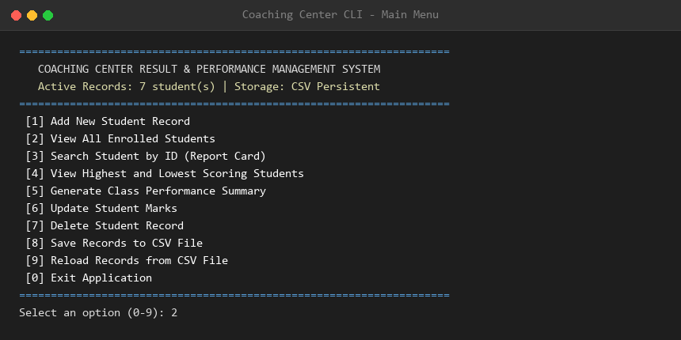
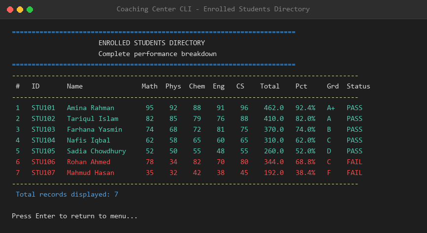
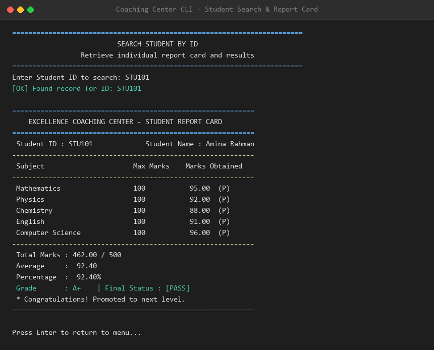
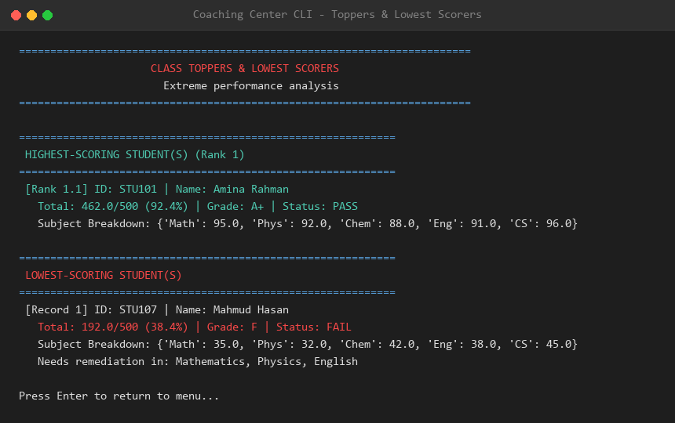
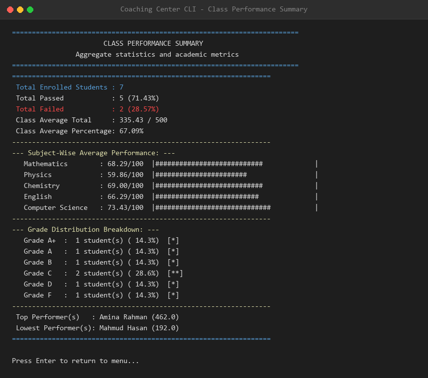
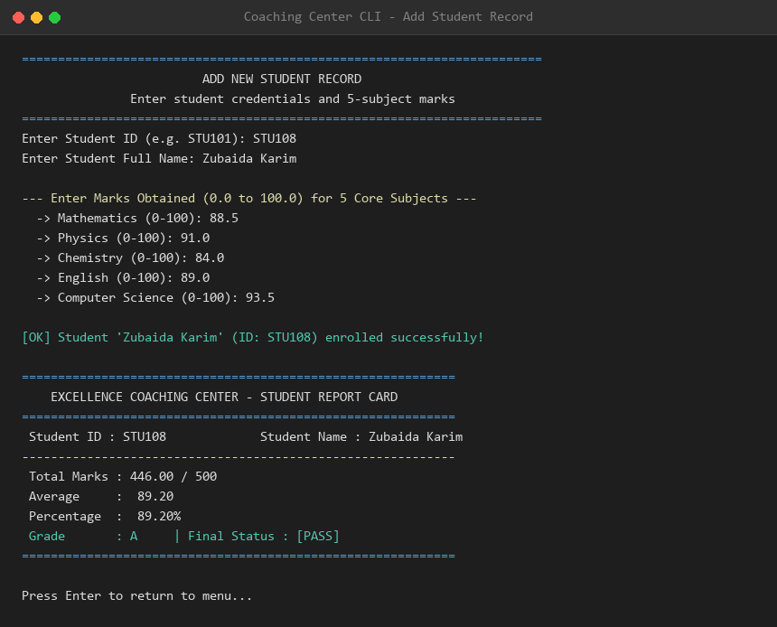

# 🎓 Coaching Center Student Result & Performance Management System

An Object-Oriented Python application designed for coaching centers and academic institutions to manage student marks, automate result calculations, determine pass/fail criteria, generate comprehensive performance reports, and persist records across sessions via CSV storage.

---

## 📋 Table of Contents
- [Overview](#-overview)
- [Key Features](#-key-features)
- [System Architecture](#-system-architecture)
- [Explanation of Main Classes & Functions](#-explanation-of-main-classes--functions)
- [Academic Grading & Pass/Fail Rules](#-academic-grading--passfail-rules)
- [Screenshots & Visual Demos](#-screenshots--visual-demos)
- [Installation & How to Run](#-installation--how-to-run)
- [Running Automated Unit Tests](#-running-automated-unit-tests)
- [GitHub Repository Setup Guide](#-github-repository-setup-guide)

---

## 🌟 Overview
Educational coaching centers evaluate students across multiple subjects and require an accurate, reliable, and automated system to assess performance, rank students, highlight areas for improvement, and maintain records permanently.

This terminal-based system is built adhering to **Object-Oriented Programming (OOP)** principles, providing an intuitive, menu-driven CLI interface with robust input validation, real-time calculations, statistical analysis, and persistent storage.

---

## ✨ Key Features

1. **Object-Oriented Design (`Student` & `ResultManager`)**: Clean separation of student state/calculations from collection management and persistence.
2. **5 Core Subjects Evaluation**:
   - Mathematics
   - Physics
   - Chemistry
   - English
   - Computer Science
3. **Automated Calculations**:
   - **Total Marks**: Sum of all 5 subjects (out of 500).
   - **Average Marks**: Mean score across subjects.
   - **Percentage**: Standardized percentage score.
   - **Letter Grade**: Evaluated via conditional grading scale (`A+`, `A`, `B`, `C`, `D`, `F`).
4. **Conditional Pass/Fail Logic**:
   - Enforces both subject-level minimum standards (≥ 40 per subject) and overall passing percentage (≥ 40%).
   - Flags specific subjects requiring re-examination.
5. **Fast Search by Student ID**:
   - Instant case-insensitive lookup.
   - Generates an official, formatted **Academic Report Card** complete with remarks.
6. **Class Toppers & Lowest Scorers Analysis**:
   - Identifies rank 1 high achievers and lowest-scoring students.
   - Properly accounts for multiple students tied for the same score.
7. **Comprehensive Class Performance Summary**:
   - Total enrolled students, pass vs. fail counts, and overall pass rate.
   - Class average marks and percentages.
   - Visual terminal bar charts for subject-wise averages.
   - Full grade distribution breakdown.
8. **Interactive Menu-Driven Interface**:
   - Built using loops and dedicated handler functions.
   - Fault-tolerant with input validation (handles strings, numeric boundaries, duplicates).
9. **Bonus Challenge - CSV Persistence**:
   - Automatically loads existing records on startup from `data/students.csv`.
   - Auto-saves all additions, edits, and deletions so data remains permanently available.

---

## 🏗️ System Architecture

```
Project 01/
├── data/
│   └── students.csv                # Persistent CSV storage with student records
├── screenshots/
│   ├── 01_main_menu.png            # Main navigation menu
│   ├── 02_view_all_students.png    # Tabular student directory
│   ├── 03_search_student_report.png# Academic report card view
│   ├── 04_high_low_scorers.png     # Class toppers and lowest scorers
│   ├── 05_class_summary.png        # Class statistical performance summary
│   └── 06_add_student.png          # Add student workflow
├── src/
│   ├── __init__.py                 # Package initializer
│   ├── student.py                  # Student class (attributes, metrics, report card)
│   ├── result_manager.py           # ResultManager class (CRUD, stats, CSV load/save)
│   └── utils.py                    # Terminal styling, banners, table rendering & input validation
├── tests/
│   ├── __init__.py
│   └── test_system.py              # Automated unit tests (14 test cases, 100% pass)
├── generate_screenshots.py         # Visual screenshot generator script
├── main.py                         # Menu-driven application entry point
├── requirements.txt                # Optional dependencies (Pillow for screenshot rendering)
├── .gitignore                      # Git ignore file for Python environments
└── README.md                       # Comprehensive documentation & evaluation guide
```

---

## 🔍 Explanation of Main Classes & Functions

### 1. `Student` Class (`src/student.py`)
Encapsulates an individual student's credentials, subject marks, and calculated academic metrics.

- **Attributes**:
  - `student_id` *(str)*: Unique uppercase identifier (e.g., `STU101`).
  - `name` *(str)*: Student's full name.
  - `marks` *(dict)*: Dictionary mapping the 5 subject names to float marks (0–100).
  - `total_marks` *(float)*: Computed sum of marks across all 5 subjects.
  - `average_marks` *(float)*: Total marks divided by 5.
  - `percentage` *(float)*: `(Total Marks / 500) * 100`.
  - `grade` *(str)*: Letter grade assigned based on percentage.
  - `status` *(str)*: `"PASS"` or `"FAIL"` based on conditional criteria.
- **Key Methods**:
  - `calculate_total()`: Sums the marks dictionary values.
  - `calculate_average()`: Computes arithmetic mean.
  - `calculate_percentage()`: Computes percentage out of 500 max marks.
  - `calculate_grade()`: Conditional logic branching for grades `A+`, `A`, `B`, `C`, `D`, `F`.
  - `calculate_status()`: Verifies if any subject score is `< 40` or overall percentage `< 40%`.
  - `get_failed_subjects()`: Returns list of subject names where mark is `< 40`.
  - `generate_report_card()`: Formats an official ASCII report card for terminal display.
  - `to_dict()` & `from_dict()`: Enables clean CSV serialization and deserialization.

### 2. `ResultManager` Class (`src/result_manager.py`)
Manages the collection of students, coordinates business logic, generates statistical summaries, and handles file I/O.

- **Attributes**:
  - `students` *(dict)*: Dictionary storing `Student` instances keyed by `student_id` for $O(1)$ fast lookups.
  - `csv_filepath` *(str)*: Path to the persistent CSV file (`data/students.csv`).
- **Key Methods**:
  - `add_student(student)`: Adds a new `Student`, preventing duplicate IDs.
  - `search_student(student_id)`: Case-insensitive search returning the `Student` object or `None`.
  - `get_all_students(sort_by)`: Returns students sorted by ID, Name, or Total Score.
  - `get_highest_scoring_students()`: Finds student(s) with maximum total marks (handles ties).
  - `get_lowest_scoring_students()`: Finds student(s) with minimum total marks (handles ties).
  - `generate_class_summary()`: Aggregates metrics including pass/fail count, pass percentage, subject averages, and grade distribution.
  - `update_student_marks(student_id, new_marks)`: Updates marks and triggers metric recalculation.
  - `delete_student(student_id)`: Removes a student record.
  - `save_to_csv()`: Exports all students and marks to the CSV file.
  - `load_from_csv()`: Reads and instantiates students from CSV file on startup.

### 3. Application Workflow & Menu Functions (`main.py`)
- `main()`: Orchestrates the central `while True` application loop and cleanly handles exits.
- `display_menu(manager)`: Displays formatted navigation options with current student count.
- `handle_add_student(manager)`: Guides the user through entering ID, Name, and 5 marks with input boundary validation (`0.0` to `100.0`).
- `handle_view_all_students(manager)`: Displays a formatted table with sorting options.
- `handle_search_student(manager)`: Prompts for ID and renders the student's report card.
- `handle_highest_lowest(manager)`: Displays the highest and lowest scoring students.
- `handle_class_summary(manager)`: Outputs aggregate statistics and terminal bar charts.
- `handle_update_marks(manager)`: Modifies marks for existing students.
- `handle_delete_student(manager)`: Removes student records with explicit user confirmation.

---

## 📊 Academic Grading & Pass/Fail Rules

### Grading Scale
| Percentage Range | Grade | Description |
| :---: | :---: | :---: |
| **90.0% – 100.0%** | **A+** | Outstanding |
| **80.0% – 89.99%** | **A** | Excellent |
| **70.0% – 79.99%** | **B** | Good |
| **60.0% – 69.99%** | **C** | Average |
| **50.0% – 59.99%** | **D** | Below Average |
| **Below 50.0%** | **F** | Fail / Needs Remediation |

### Pass/Fail Conditional Logic
A student is awarded a **"PASS"** status if and only if:
1. They score **$\ge 40$ marks** in **every single subject** ($Mathematics, Physics, Chemistry, English, Computer Science$).
2. Their overall percentage is **$\ge 40\%$**.

If a student scores below 40 in even one subject, their status is set to **"FAIL"**, and the system identifies the specific subject(s) requiring re-examination.

---

## 🖼️ Screenshots & Visual Demos

### 1. Main Navigation Menu
Shows the clean terminal dashboard with record counts and options.


---

### 2. Enrolled Students Directory (Tabular View)
Complete directory displaying IDs, Names, individual subject scores, Total, Percentage, Grade, and Status.


---

### 3. Student Search & Academic Report Card
Detailed individual report card with subject breakdown and promotion remarks.


---

### 4. Class Toppers & Lowest Scorers
Analysis of top and bottom performers with marks and remediation warnings.


---

### 5. Class Performance Summary & Analytics
Aggregate pass percentage, subject-wise performance bar charts, and grade distribution.


---

### 6. Adding a New Student Record
Step-by-step entry workflow with real-time mark validation and instant report generation.


---

## 🚀 Installation & How to Run

### Prerequisites
- Python 3.8 or higher installed on your computer.
- Git (optional, for cloning).

### Step 1: Clone or Navigate to the Project
```bash
git clone https://github.com/<your-username>/student-result-management-system.git
cd student-result-management-system
```
*(Or navigate to `d:\Advanced Python\Project 01` if running locally)*

### Step 2: (Optional) Create & Activate a Virtual Environment
- **Windows (PowerShell)**:
  ```powershell
  python -m venv .venv
  .\.venv\Scripts\Activate.ps1
  ```
- **Linux / macOS**:
  ```bash
  python3 -m venv .venv
  source .venv/bin/activate
  ```

### Step 3: Run the Application
The core application runs purely on Python standard library modules (`csv`, `os`, `sys`, `typing`, `unittest`):
```bash
python main.py
```

---

## 🧪 Running Automated Unit Tests

A full test suite covering all calculations, grade assignments, pass/fail rules, search queries, tie breaking, and CSV persistence is included in `tests/test_system.py`.

Run the tests using Python's built-in `unittest` runner:
```bash
python -m unittest discover -s tests -v
```

### Test Suite Results:
```text
test_add_and_search_student (test_system.TestResultManagerClass.test_add_and_search_student) ... ok
test_class_summary_generation (test_system.TestResultManagerClass.test_class_summary_generation) ... ok
test_csv_save_and_load (test_system.TestResultManagerClass.test_csv_save_and_load) ... ok
test_delete_student (test_system.TestResultManagerClass.test_delete_student) ... ok
test_duplicate_id_rejected (test_system.TestResultManagerClass.test_duplicate_id_rejected) ... ok
test_highest_and_lowest_scoring_students (test_system.TestResultManagerClass.test_highest_and_lowest_scoring_students) ... ok
test_highest_lowest_ties (test_system.TestResultManagerClass.test_highest_lowest_ties) ... ok
test_calculations_perfect_score (test_system.TestStudentClass.test_calculations_perfect_score) ... ok
test_calculations_standard_student (test_system.TestStudentClass.test_calculations_standard_student) ... ok
test_grade_boundaries (test_system.TestStudentClass.test_grade_boundaries) ... ok
test_invalid_mark_raises_exception (test_system.TestStudentClass.test_invalid_mark_raises_exception) ... ok
test_pass_fail_conditional_logic (test_system.TestStudentClass.test_pass_fail_conditional_logic) ... ok
test_report_card_output (test_system.TestStudentClass.test_report_card_output) ... ok
test_serialization_dict (test_system.TestStudentClass.test_serialization_dict) ... ok

----------------------------------------------------------------------
Ran 14 tests in 0.011s

OK
```

---

## 📤 GitHub Repository Setup Guide

To submit this project to your GitHub account:

1. **Initialize Git Repository** (if not already done):
   ```bash
   git init
   git add .
   git commit -m "Initial commit: Coaching Center Student Result Management System"
   ```

2. **Create a New Repository on GitHub**:
   - Go to [GitHub New Repository](https://github.com/new).
   - Set repository name: `student-result-management-system` (or `coaching-center-result-manager`).
   - Leave it **Public**.
   - Do **not** initialize with a README, .gitignore, or license (they are already present).

3. **Link Remote and Push**:
   ```bash
   git branch -M main
   git remote add origin https://github.com/<your-github-username>/student-result-management-system.git
   git push -u origin main
   ```

4. **Your Submission Link**:
   ```
   https://github.com/<your-github-username>/student-result-management-system
   ```

---

## 👨‍💻 Evaluation Preparation Summary
During evaluation, you can present:
- **OOP Architecture**: Explain how `Student` models domain entities while `ResultManager` orchestrates collections and business logic.
- **Robustness**: Point out how input validation catches invalid strings, non-numeric values, marks outside 0-100, and duplicate student IDs.
- **Ties in High/Low Scorers**: Show how `get_highest_scoring_students()` and `get_lowest_scoring_students()` return lists rather than single values so tied students are not excluded.
- **CSV Data Integrity**: Demonstrate adding a student, terminating the app, restarting it, and showing that the student record persisted.

